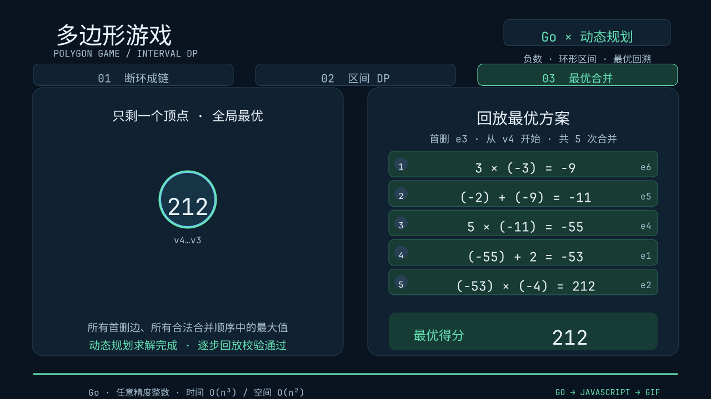
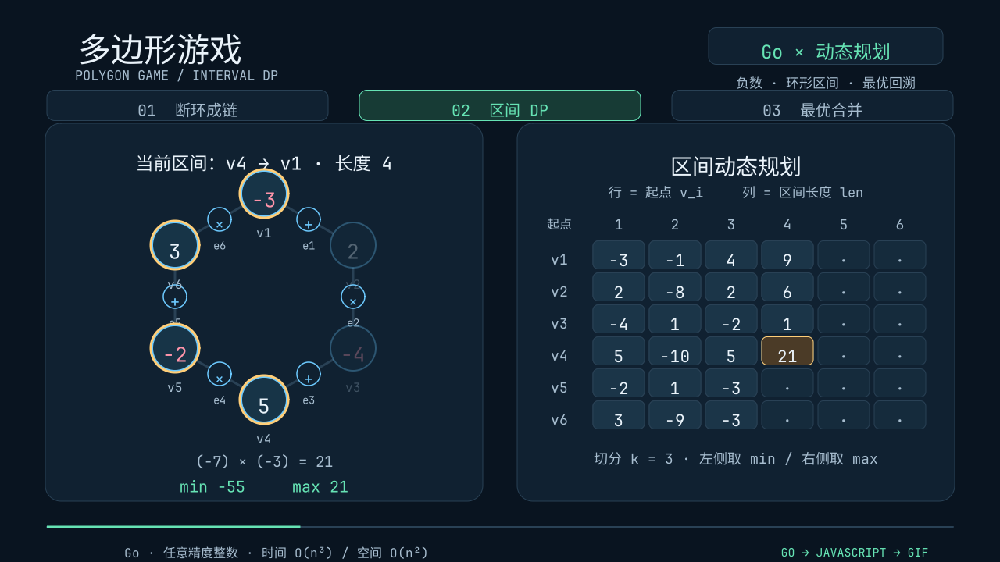

# 多边形游戏：Go 动态规划 + JavaScript 教学动画

已实现可运行的 Go 求解器、合法合并方案回放、运行样例和 GIF 动画。算法使用 Go；动画的图形、排版、各阶段和运动全部使用 JavaScript 编写，交给当前项目的引擎绘制。

## 1. 文件

| 文件 | 用途 |
| --- | --- |
| [../../polygon/game.go](../../polygon/game.go) | 输入校验、区间 DP、最优方案回溯、合法合并回放 |
| [../../polygon/game_test.go](../../polygon/game_test.go) | 经典样例、穷举对照、负数、零、并列答案和大整数测试 |
| [../../cmd/polygon-game/main.go](../../cmd/polygon-game/main.go) | Go 命令行入口，输出结果并可生成 JS / GIF / PNG |
| [../../polygon/visual/template.js](../../polygon/visual/template.js) | 动画的 JavaScript 源模板；全部绘图与运动逻辑在这里 |
| [../../polygon/visual/generate.go](../../polygon/visual/generate.go) | 只把 Go 的真实结果填入 JS，不在 Go 中编写动画逻辑 |
| [animation.js](animation.js) | 本次样例的独立 JS 动画，可直接预览、编辑、导出 |
| [sample.in](sample.in) | 六边形输入样例 |
| [classic.in](classic.in) | 四边形经典样例 |
| [negative.in](negative.in) | 最优得分仍为负数的样例 |
| [result.txt](result.txt) | 六边形样例的实际运行输出 |
| [classic-result.txt](classic-result.txt) / [negative-result.txt](negative-result.txt) | 另外两组样例的实际运行输出 |
| [result.json](result.json) | 完整 DP 状态、各删边得分、最优表达式和合并步骤 |
| [polygon-game.gif](polygon-game.gif) | 约 29 秒、1280 × 720、12 fps 的完整教学动画 |
| [result.png](result.png) | 动画最终结果截图 |
| [dp.png](dp.png) | 填写 DP 表过程的截图 |

## 2. 游戏规则

1. 多边形的 `n` 个顶点按顺序放整数，允许负数和零。
2. 每条边标记 `+` 或 `*`。
3. 首先免费删除一条边，不做任何运算，使环变成一条链。
4. 每次选择链上的一条边，把两端的相邻顶点按该边的运算符合并为一个新顶点。
5. 继续进行 `n−1` 次合并，最后剩下的数就是得分。
6. 求所有首删边、所有合法合并顺序中的最大得分。

顶点顺序不能任意交换。先合并哪条边相当于先计算哪一对括号，**不是按乘法优先于加法的普通表达式规则直接计算**。

本实现约定：`e_i` 连接 `v_i → v_(i+1)`，`e_n` 连接 `v_n → v_1`。删除 `e_i` 后，链从 `v_(i+1)` 开始，编号循环。

## 3. 输入格式与运行

以下命令均在项目根目录运行，使用项目现有的 Go 依赖即可。

```text
n
a1 a2 ... an
op1 op2 ... opn
```

`n` 为 `3..100`；整数为十进制；支持 `+`、`*`，也接受 `x` / `×` 作为乘号。空格和换行可互换。动画为了保证可读性支持 `3..8` 个顶点。

```powershell
# 默认六边形样例
go run ./cmd/polygon-game

# 指定输入文件
go run ./cmd/polygon-game -input examples/polygon-game/classic.in

# 标准输入（PowerShell）
Get-Content examples/polygon-game/sample.in | go run ./cmd/polygon-game -input -

# 查看全部参数
go run ./cmd/polygon-game -h
```

### 样例一：六边形，最优得分 212

输入 [sample.in](sample.in)：

```text
6
-3 2 -4 5 -2 3
+ * + * + *
```

各首删边的实际结果：

| 首删边 | 链起点 | 该删边方案的最大得分 |
| --- | --- | ---: |
| e1 | v2 | 75 |
| e2 | v3 | 35 |
| e3 | v4 | **212** |
| e4 | v5 | 41 |
| e5 | v6 | 98 |
| e6 | v1 | 17 |

删除 `e3` 后，链为：

```text
v4(5) --*-- v5(-2) --+-- v6(3) --*-- v1(-3) --+-- v2(2) --*-- v3(-4)
```

回溯得到的合法合并顺序：

```text
1. 沿 e6：  3 * (-3)  = -9
2. 沿 e5： -2 + (-9)  = -11
3. 沿 e4：  5 * (-11) = -55
4. 沿 e1：-55 + 2     = -53
5. 沿 e2：-53 * (-4)  = 212
```

对应完整括号表达式：

```text
(((5 * ((-2) + (3 * (-3)))) + 2) * (-4)) = 212
```

完整原始输出见 [result.txt](result.txt)。每一步都通过 `Replay` 检查，包括顶点相邻关系、原始边编号、操作数和运算结果。

### 样例二：经典四边形

```powershell
go run ./cmd/polygon-game -input examples/polygon-game/classic.in
```

```text
4
-7 4 2 5
+ * * +
```

结果：最大得分 `33`，全部最优首删边为 `[1 4]`。程序确定性地选择编号较小的 `e1` 演示，但保留所有并列最优首删边。

### 样例三：答案可以是负数

```powershell
go run ./cmd/polygon-game -input examples/polygon-game/negative.in
```

```text
3
-2 -3 -4
* * *
```

结果：最大得分 `-24`，最优首删边为 `[1 2 3]`。DP 初值不能随意设为 `0`，否则会在这个样例中产生错误答案。

## 4. 动态规划算法

### 断环成链

把顶点数组复制一次，得到 `a[0..2n)`。从每个起点 `s ∈ [0,n)` 取连续 `n` 个顶点，就能覆盖全部首删边方案。

定义：

```text
lo[s][len] = 从 s 开始、含 len 个连续顶点的链，能得到的最小值
hi[s][len] = 从 s 开始、含 len 个连续顶点的链，能得到的最大值
```

长度为 `1` 时：

```text
lo[s][1] = hi[s][1] = a[s % n]
```

### 枚举最后一次合并的位置

令左段长度为 `k`，`1 <= k < len`：

```text
左段：dp[s][k]
右段：dp[s+k][len-k]
连接运算符：op[(s+k-1) % n]
```

对两侧最小值 / 最大值的四种组合计算候选值：

```text
loLeft op loRight
loLeft op hiRight
hiLeft op loRight
hiLeft op hiRight
```

在所有 `k` 和全部候选值中，取最小值得到 `lo[s][len]`，取最大值得到 `hi[s][len]`。加法实际上只需要 `lo+lo` 与 `hi+hi`，代码统一枚举四种组合，便于理解与回溯。

不能只保存最大值。例如本次最优解的最后一次运算是 `(-53) × (-4) = 212`；若丢弃前一段的最小值 `-53`，就会漏掉答案。

### 全局答案与回溯

```text
answer = max(hi[s][n]), 0 <= s < n
```

每个区间分别记录取得最小值和最大值时的切分位置，以及两个子区间应该使用 `min` 还是 `max`。从最终最大值开始递归回溯，先完成左右子区间，再合并当前边，即得到合法的操作顺序。

复杂度为 `O(n³)` 次整数运算、`O(n²)` 个 DP 状态。使用 `math/big.Int` 防止整数溢出；大整数的位数会额外影响时间和存储成本。JSON 中数值保存为字符串，因此传给 JS 时不会受到 `Number` 的 53 位精度限制。

## 5. JavaScript 动画与 GIF

动画分为：规则说明 → 断环建模 → DP 表按长度填充 → 比较全部首删边 → 展开最优链 → 逐步合并 → 最终得分。

左侧高亮当前区间，右侧显示 DP 表；同时展示当前 `min`、`max` 和切分来源。回放时，两个相邻顶点向合并位置靠拢，运算边消失，新数值出现，右侧同步记录计算步骤。

`animation.js` 内置本次 Go 计算数据，不读取外部 JSON。所有对象加载时创建一次，每帧只根据绝对时间修改位置、缩放和透明度，支持重新播放和任意时间跳转。

### 直接预览与导出已有 JS

```powershell
go run . preview examples/polygon-game/animation.js

go run . gif -fps 12 examples/polygon-game/animation.js examples/polygon-game/polygon-game.gif

go run . render -time 8 examples/polygon-game/animation.js examples/polygon-game/dp.png
```

预览窗口支持项目已有的播放、暂停、拖动进度和重新播放控件。

### 换一组数据，重新求解并生成动画

```powershell
go run ./cmd/polygon-game -input examples/polygon-game/sample.in -js examples/polygon-game/animation.js -gif examples/polygon-game/polygon-game.gif -png examples/polygon-game/result.png -json examples/polygon-game/result.json -report examples/polygon-game/result.txt
```

可附加 `-fps 10` 或 `-scale 0.75` 缩小 GIF；`-scale 2` 增大输出像素尺寸，但不会凭空增加原始内容。

重新指定 `-js` 会覆盖该生成文件。需要长期修改通用动画时，编辑 [template.js](../../polygon/visual/template.js)；只调整这次样例时，可以直接编辑生成的 [animation.js](animation.js)，随后用项目根命令预览 / 导出，不必重新生成。

## 6. 测试与验证

```powershell
go test ./polygon/... ./cmd/polygon-game
go test ./...
```

覆盖内容：

- 经典样例 `33`、并列最优删边、全负数和零。
- 175 组固定种子的随机多边形，对 4725 个 DP 区间状态的最小值 / 最大值逐个与穷举括号方案比较。
- 超出 64 位整数范围的计算，以及超过 JS 精确整数范围的数据传递。
- 每一步回溯合并的相邻关系、操作数、边和结果校验。
- 无效顶点数量、缺少输入、非法运算符、多余内容和无效参数。
- 3、4、8 个顶点的 JS 场景加载；跳转至末尾再返回第 8 秒，与第一次绘制的像素哈希一致。

交付的 GIF 另经实际解码检查：344 帧、1280 × 720、总时长 28.67 秒、循环播放，并已抽取规则、DP、展开、合并与最终结果画面进行目视检查。




